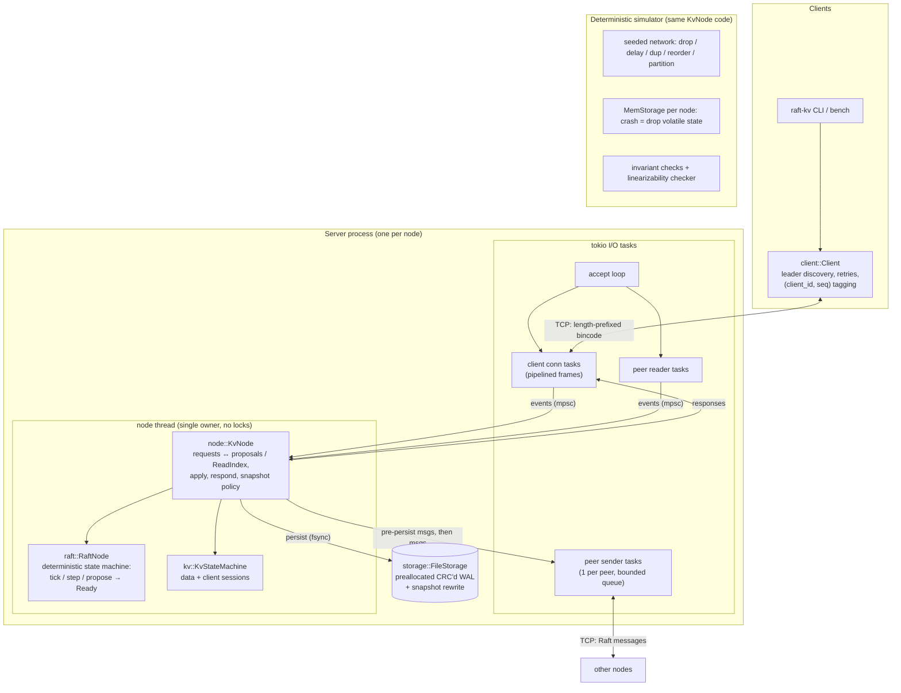

# raft-kv

**raft-kv** is a small etcd-style replicated key-value store written in Rust. The Raft
consensus layer is built from scratch, with no Raft crates. The consensus core and the
server logic are deterministic state machines with no I/O, so the *same code* that serves
traffic over TCP also runs inside a seeded simulator. The simulator drops, delays,
duplicates and reorders messages, partitions the network, and crashes and restarts nodes
(including in the middle of a disk write). Across every run it checks Raft's safety
invariants, and at the end of each run it checks the full client history for
linearizability. The release build passed 160,000 seeds (80 million client operations).
Mutation testing shows the harness catches deliberately injected consensus bugs.

---

## Features

**Consensus (Raft, from scratch)** — [`src/raft/`](src/raft)
- Leader election with randomized timeouts, **pre-vote** (thesis §9.6) and **check-quorum**
- Log replication with pipelining, per-follower flow control (probe / replicate / snapshot
  states, bounded in-flight window), fast conflict backtracking, lost-message recovery
- Commit rule that only counts entries from the leader's current term (Figure 8)
- Durable term, vote and log; log compaction via snapshots; **InstallSnapshot** for lagging followers
- The leader writes to its disk *in parallel* with replication (thesis §10.2.1) and counts
  itself toward the commit quorum only for entries that are already durable

**Key-value store** — [`src/kv/`](src/kv), [`src/node.rs`](src/node.rs)
- `get`, `put`, `delete`, `compare-and-swap` (CAS can also create or delete a key)
- **Linearizable reads via ReadIndex**: no clock assumptions, and reads that arrive
  together share one heartbeat round
- **Exactly-once writes**: every write carries `(client_id, seq)`. The state machine caches
  the last result per client, so a retry after a lost response returns the original result
  instead of executing again. Sessions are part of the snapshot.

**Storage** — [`src/storage.rs`](src/storage.rs)
- Write-ahead log of CRC32-checksummed records, one `write` + `fsync` per batch (group commit)
- **Preallocated, zero-filled WAL.** Profiling showed that on APFS, writes that extend a file
  stall for 1–3 ms; writes into preallocated blocks take microseconds (details below).
- Torn or corrupt tails are detected and scrubbed on recovery. A snapshot atomically rewrites
  the WAL (temp file + `rename` + directory fsync).

**Networking and tools**
- Async (tokio) TCP transport with a hand-rolled length-prefixed bincode protocol, persistent
  peer connections and pipelined client connections
- `raft-kv` CLI: run a server, run a local N-node cluster, `get/put/delete/cas/status`, `bench`
- `scripts/cluster.sh`: start a 3-process cluster you can `kill -9`

**Verification**
- 65 tests: 52 unit, 6 end-to-end over real TCP (ephemeral ports), 7 simulation suites
- Deterministic simulator ([`src/sim.rs`](src/sim.rs)) with continuous checks of election
  safety, log matching, leader completeness and state machine safety, plus liveness, replica
  convergence and linearizability checks at the end of each run
- A Wing–Gong / Lowe linearizability checker (the algorithm behind Porcupine) ([`src/linearizability.rs`](src/linearizability.rs))
- [`scripts/mutation_test.py`](scripts/mutation_test.py): injects 9 classic Raft/KV bugs and
  confirms the tests catch each one

---

## Architecture



The driver loop has one job: carry out the effects the core asks for, in the order the core
specifies. This is the entire contract between the deterministic core and the I/O shell:

```
loop:
    wait for an event (client request, peer message) or the next tick
    feed it (and everything else already queued) into KvNode     ← batching
    loop:
        out = node.poll()
        send(out.pre_persist_messages)   ← leader replication, overlaps with our fsync
        storage.persist(out.persist)     ← one write + fsync for the whole batch
        node.advance()                   ← "that batch is durable": may commit
        send(out.messages)               ← votes/acks: only after they're durable
        respond(out.responses)
```

**Write path:** client → leader `propose` → AppendEntries to followers (sent before the
leader's own fsync) → followers persist and ack → leader's entry is durable *and* a
majority has acked → commit → apply → respond.

**Read path (ReadIndex):** client → leader records `read_index = commit_index` → one
heartbeat round. If a majority acks, nobody has deposed this leader since the read
arrived → wait until `applied ≥ read_index` → serve from the local state machine. A new
leader first waits until its election no-op commits, because before that it does not
know the real commit index.

### Module map

| Module | Responsibility | Does I/O? |
|---|---|---|
| [`raft`](src/raft) | Elections, replication, commit, snapshots, ReadIndex | no |
| [`kv`](src/kv/mod.rs) | KV state machine + client sessions (dedup) | no |
| [`node`](src/node.rs) | Glue: client requests ↔ Raft ↔ state machine, snapshot policy | no |
| [`storage`](src/storage.rs) | WAL + snapshots (`FileStorage`), in-memory twin (`MemStorage`) | disk |
| [`server`](src/server.rs) | Node thread + tokio TCP transport | network, disk |
| [`client`](src/client.rs) | Leader discovery, retries, exactly-once tagging | network |
| [`cluster`](src/cluster.rs), [`bench`](src/bench.rs) | In-process N-node cluster; load generator | network |
| [`sim`](src/sim.rs) | Deterministic cluster simulation with fault injection | no |
| [`linearizability`](src/linearizability.rs) | History checker | no |

---

## Key design decisions and tradeoffs

**1. A sans-I/O core, so the simulator tests production code.**
`RaftNode` and `KvNode` take inputs (`tick`, `step`, `propose`, `handle_client`) and
return effects (`Ready` / `Output`). They never touch clocks, sockets, disks or a global
RNG, and they iterate only over ordered maps (`BTreeMap`). A run is therefore a pure
function of the seed: `raft-sim --seed N` reproduces any failure exactly. The cost is a
stricter contract for drivers (persist → advance → send). It is written down in one place
(`raft::Ready`) and followed by only two drivers: the tokio server and the simulator.

**2. ReadIndex rather than leader leases for linearizable reads.**
A lease lets a leader answer reads locally, but its safety depends on bounded clock drift
and on the leader noticing that the lease expired. A GC pause, VM migration or a clock jump
breaks that assumption silently. ReadIndex costs one heartbeat round (about 0.1 ms on
localhost) but depends only on message ordering. To amortize the round, every read
registered between two `ready()` calls shares one heartbeat broadcast. Reads always go to
the leader; follower reads (which ReadIndex would also allow) are future work.

**3. Pre-vote and check-quorum.** Without pre-vote, a node that was partitioned away keeps
bumping its term, and when it rejoins it forces a healthy leader to step down. Pre-vote
makes it ask "would you vote for me?" first, and peers that have heard from a leader
recently say no. Check-quorum makes a leader that cannot reach a majority step down. Its
clients then get a fast "not leader" instead of timing out. The simulator runs with and
without pre-vote.

**4. Exactly-once through client sessions.** Retrying a non-idempotent write (CAS, delete)
after a lost response can apply it twice. Each client numbers its writes, and the state
machine stores `(last_seq, last_result)` per client, replicated through the log and the
snapshots. A retry returns the cached result. Tradeoff: one outstanding write per client
session (use more sessions for concurrency), and sessions never expire (see Limitations).

**5. One owner thread per node, tokio for sockets.** All consensus state lives on one OS
thread, which drains every queued event before persisting. A burst of proposals becomes
one WAL write, one fsync and one AppendEntries per follower: group commit without any
explicit batching code. Sockets live in tokio tasks. Raft messages are fire-and-forget
through bounded per-peer queues. A slow peer causes drops, never back-pressure on
consensus; Raft retransmits.

**6. Overlapping the leader's fsync with replication (thesis §10.2.1).** The leader sends
AppendEntries *before* writing the entries locally. It counts itself toward a commit only
up to its `stable_index`, which advances when the driver confirms durability via
`advance()`. With fsync on, this removes one full disk flush from the write critical path
(measured during development: p50 16 ms → 10 ms for a single client; 8 ms on an idle machine). To make sure the
optimization is safe, the simulator injects crashes exactly between "sent entries" and
"entries hit disk": 92,000+ such crashes across the 100k-seed run.

**7. A preallocated WAL, found by profiling.** The first benchmark showed single-client
writes at p50 ≈ 3.6 ms *with fsync off*, far too slow for localhost. Timing the node loop
showed the time was in a plain `write()` to the WAL. A standalone test confirmed that on
this APFS volume, appends that **extend** a file stall for 1–3 ms when spaced out like real
traffic, while overwriting **preallocated** (zero-filled, not sparse) blocks takes µs:

| 400 × 200-byte writes, 1 ms apart | p50 | p99 | writes > 0.5 ms |
|---|---:|---:|---:|
| extending the file | 2175 µs | 3865 µs | 232 / 400 |
| into a sparse `ftruncate`d region | 13 µs | 2570 µs | 10 / 400 |
| into a zero-filled region | 6 µs | 63 µs | 0 / 400 |

The WAL now grows in 16 MiB zero-filled steps (etcd preallocates WAL segments for the same
reason), and replay stops at the first all-zero header. Single-client fsync-off write
throughput rose from **258 to ~9,000 ops/s** (measured during development on a loaded machine; ~12,700 ops/s on an idle one).

**8. A hand-rolled framing protocol instead of gRPC.** A length-prefixed bincode frame
carries everything: Raft messages and pipelined client requests tagged with ids. This keeps
dependencies small and gives full control over batching. Responses waiting on one
connection are coalesced into one `write`. The tradeoff: no cross-language clients, no
schema evolution story, and no TLS.

**9. Snapshots are simple on purpose.** The whole state machine (data + sessions) is
serialized with bincode on the node thread once `snapshot_threshold` entries have been
applied. It is sent as a single InstallSnapshot message. That is fine for the sizes this
project targets, and the limits are listed below.

---

## Testing

```bash
cargo test                       # 65 tests; simulation suites run 1,000 seeds each
SIM_SEEDS=10000 cargo test --release --test simulation
cargo run --release --bin raft-sim -- --seeds 100000        # big parallel sweep
cargo run --release --bin raft-sim -- --seed 4242 --verbose # replay one seed
python3 scripts/mutation_test.py                            # does the harness catch bugs?
```

### The simulator

Each seed builds a cluster of `KvNode`s (3 or 5 nodes, plus a single-node suite) and 5
clients that issue a random mix of get / put / delete / CAS over 3 hot keys. Time runs in
discrete units, and **everything nondeterministic comes from one ChaCha8 RNG**. The seed
also randomizes the Raft tunables (batch size 1–64, in-flight window 1–8192, snapshot
threshold, client timeout), so the seed space covers configurations as well as schedules.

| Fault | How |
|---|---|
| Message loss | 5% of all messages (Raft and client) dropped |
| Reordering | 3% of messages delayed up to 15× the normal latency |
| Duplication | 2% of messages delivered twice |
| Partitions | ~1 per 1000 time units: isolate the leader, a random node, or a random 2-way split |
| Crashes | ~1 per 1000 time units: the node loses all volatile state and restarts from its simulated disk |
| Crash mid-persist | a node crashes after sending its pre-persist messages but before its disk write lands |
| Clock skew | each node ticks at its own rate (±10%) |

Checked continuously: **election safety** (one leader per term), **log matching** (all
pairs of logs, every 50 time units), **leader completeness** (a new leader holds every
entry already applied anywhere), **state machine safety** (no two nodes apply different
entries at the same index). Checked at the end of each run: **liveness** (after faults stop,
every outstanding operation completes), **convergence** (all replicas reach the same state
digest) and **linearizability** of the complete history, key by key (linearizability
is compositional).

**Results (release build, this machine):**

| Profile | Seeds | Client ops | Leader elections | Crashes (mid-persist) | Partitions | Snapshots installed | Result |
|---|---:|---:|---:|---:|---:|---:|---|
| 5 nodes, default faults | 100,000 | 62.3 M | 638,365 | 1,088,998 (92,162) | 568,457 | 461,476 | **all pass** |
| 3 nodes, default faults | 30,000 | 15.3 M | 211,086 | 303,281 (13,705) | 170,199 | 45,982 | **all pass** |
| 5 nodes, 4× faults, no pre-vote | 30,000 | 3.0 M | 207,240 | 1,072,531 (6,940) | 296,787 | 27,792 | **all pass** |

A run of 10,000 seeds takes about 10 s on 10 cores. Two seeds with the same configuration
produce bit-identical traces; a test asserts this.

### Does the harness actually catch bugs?

A test suite that never fails proves little. `scripts/mutation_test.py` copies the crate to
a temp dir, applies one classic bug at a time, and runs the unit tests plus 3,000 simulator
seeds under two fault profiles:

| Injected bug | Unit tests | Sim (default) | Sim (4× faults, no pre-vote) |
|---|:---:|---:|---:|
| Votes ignore the log up-to-date check (§5.4.1) | killed | 2113 / 3000 | 2981 / 3000 |
| A node may vote twice in one term | — | 722 / 3000 | 640 / 3000 |
| Leader commits old-term entries by counting replicas (Figure 8) | killed | 93 / 3000 | 329 / 3000 |
| Follower keeps conflicting entries instead of truncating | killed | 2197 / 3000 | 2108 / 3000 |
| Follower commit not bounded by last new entry | killed | — | — |
| ReadIndex answered without a heartbeat round | killed | 49 / 3000 | 7 / 3000 |
| ReadIndex confirmed by 1 follower ack instead of a quorum | — | 5 / 3000 | 3 / 3000 |
| Term and vote not persisted | — | 60 / 3000 | 788 / 3000 |
| Client request deduplication disabled | killed | 2996 / 3000 | 2520 / 3000 |

Every mutant is caught by at least one layer. Two lessons came out of this exercise and fed
back into the harness:
- Randomizing the Raft tunables per seed raised the Figure 8 bug's detection from 3 to 43
  failing seeds out of 3,000 (now 93).
- Randomizing the client timeout (impatient clients fail over sooner) made stale reads from
  a deposed leader about 10× more likely to surface (5 → 49 failing seeds).

The *follower commit bound* mutant survives the simulator because this leader always
resumes replication at the first conflicting index, so the triggering message is never
sent. A targeted unit test covers it. The simulation suite also has a **negative
control**: an intentionally unsafe read mode (`ReadMode::UnsafeLeaderLocal`) must be
flagged by the linearizability checker. It is, in about 8% of seeds.

### End-to-end tests (real TCP, ephemeral ports)

[`tests/cluster.rs`](tests/cluster.rs) starts in-process clusters bound to port 0 and covers:
basic operations and follower→leader redirects; leader failure and rejoin; a full-cluster
restart from disk (with fsync); a lagging node catching up through InstallSnapshot and then
being *required* for quorum; concurrent CAS increments across a leader kill, where the final
count must be exact (this would break without dedup); and a leader cut off from its quorum,
which must refuse both reads and writes.

---

## Build, run, use

Requires Rust 1.85+ (edition 2024).

```bash
cargo build --release

# A 3-node cluster in one process (ports 7001-7003, data in ./data)
./target/release/raft-kv cluster --nodes 3

# ...or as three OS processes, so you can kill -9 one
scripts/cluster.sh          # scripts/cluster.sh stop

# Client commands (default --cluster is 127.0.0.1:7001,7002,7003)
./target/release/raft-kv put greeting hello
./target/release/raft-kv get greeting                   # "hello"
./target/release/raft-kv cas greeting --expected hello --new world
./target/release/raft-kv delete greeting
./target/release/raft-kv status
```

```
address                 id role           term leader   commit  applied     last snapshot
127.0.0.1:7001           1 leader            1      1        5        5        5        0
127.0.0.1:7002           2 follower          1      1        5        5        5        0
127.0.0.1:7003           3 follower          1      1        5        5        5        0
```

Run a single server: `raft-kv server --id 1 --peers 1=127.0.0.1:7001,2=127.0.0.1:7002,3=127.0.0.1:7003 --data-dir data/1`.
Library use: `raft_kv::client::Client::new(addrs)` then `.put(..).await`, `.get(..).await`, etc.

---

## Benchmarks

Measured with `raft-kv bench`, which starts a fresh 3-node cluster in-process on loopback
(ephemeral ports, temp data dirs), preloads 10,000 keys, and drives **closed-loop** clients:
each client issues one request, waits for the response, then issues the next. Values are
128 bytes. Each cell gets 1 s of warmup and 5 s of measurement. Every write is a replicated,
committed Raft entry, and every read is a linearizable ReadIndex read served by the leader.

**Machine:** Apple M4 laptop (10 cores), macOS, APFS SSD, Rust 1.99 release build. The
machine was otherwise idle: load average 2.5 before the runs, rising to 4.8–6.5 during them,
mostly from the benchmark's own client and server threads. Client and servers share the
machine and talk over loopback, so this measures the software path, not a real network.
Each cell is the **median of three full runs** (each column's median taken separately).

```bash
cargo run --release --bin raft-kv -- bench --clients 1,32,128 --workloads write,read,mixed --duration 5
```

| fsync | workload | clients | ops/s | p50 ms | p90 ms | p99 ms | p99.9 ms |
|---|---|---:|---:|---:|---:|---:|---:|
| off | write | 1 | 12,653 | 0.08 | 0.09 | 0.15 | 0.20 |
| off | write | 32 | 129,919 | 0.23 | 0.29 | 0.40 | 1.67 |
| off | write | 128 | 161,551 | 0.74 | 0.93 | 1.17 | 18.01 |
| off | read | 1 | 15,867 | 0.06 | 0.07 | 0.09 | 0.13 |
| off | read | 32 | 158,117 | 0.20 | 0.25 | 0.30 | 0.36 |
| off | read | 128 | 187,406 | 0.68 | 0.84 | 0.99 | 1.11 |
| off | mixed | 1 | 14,510 | 0.07 | 0.08 | 0.11 | 0.15 |
| off | mixed | 32 | 142,336 | 0.22 | 0.27 | 0.33 | 0.45 |
| off | mixed | 128 | 172,589 | 0.71 | 0.90 | 1.10 | 14.52 |
| on | write | 1 | 130 | 8.00 | 8.07 | 11.97 | 14.00 |
| on | write | 32 | 1,297 | 24.06 | 33.72 | 36.94 | 42.03 |
| on | write | 128 | 4,200 | 29.11 | 45.12 | 53.26 | 57.19 |
| on | read | 1 | 15,785 | 0.06 | 0.08 | 0.11 | 0.17 |
| on | read | 32 | 158,868 | 0.20 | 0.25 | 0.30 | 0.35 |
| on | read | 128 | 191,227 | 0.66 | 0.83 | 0.98 | 1.12 |
| on | mixed | 1 | 250 | 0.32 | 8.38 | 11.97 | 13.89 |
| on | mixed | 32 | 1,336 | 24.02 | 32.56 | 38.03 | 45.88 |
| on | mixed | 128 | 4,140 | 32.88 | 38.06 | 43.37 | 52.77 |

How to read this:
- **fsync on** means the WAL is flushed with `F_FULLFSYNC` (Rust's `sync_data` on macOS),
  which forces the drive to empty its write cache and costs a few milliseconds per flush
  here. A committed write needs the leader's flush and a follower's flush. Overlapping them
  (decision 6) brings single-client latency close to *one* flush (p50 ≈ 8 ms). Throughput
  then scales with concurrency through group commit: many clients share each flush, so 128
  clients reach ~4,200 writes/s while a single client gets ~130/s. On Linux with
  `fdatasync` on NVMe, flushes are typically far cheaper.
- **fsync off** writes still reach the OS page cache before any acknowledgement (the data
  survives a process crash, not a power loss). The software path then dominates: 0.08 ms
  p50 per committed write for one client (~12.7k writes/s), ~130k writes/s at 32 clients
  and ~160k at 128.
- **Reads** cost one heartbeat round with no disk access, and concurrent reads share
  rounds: 0.06 ms p50 for one client, ~190k reads/s at 128 clients, whether or not writes
  are fsynced.
- **Mixed with fsync on** exposes a real limitation. While the node thread is blocked in a
  flush, reads queue behind it. In the 1-client row, p50 is a read (0.3 ms) and p90 is a
  write (8 ms); at 32–128 clients, reads inherit the fsync cost. A separate persistence
  thread (see Future work) would fix this.
- The three runs agreed to within ~10–20% in almost every cell. One outlier run (the
  1-client fsync-off mixed cell, 7.8k vs ~15k ops/s) is absorbed by the median.

---

## Limitations and future work

- **No membership changes.** The voter set is fixed at startup. Joint consensus or
  single-server changes (thesis §4) would be the next feature.
- **Snapshots are stop-the-world and sent whole.** Serialization runs on the node thread,
  and InstallSnapshot is a single message (frames are capped at 256 MiB). Production
  systems snapshot from a copy-on-write view in the background and stream chunks.
- **Client sessions never expire**, so memory grows with the number of distinct client ids
  ever seen. etcd and LogCabin expire sessions using leader-assigned time carried in the log.
- **Reads always go to the leader.** ReadIndex also permits follower reads (the follower
  asks the leader for a read index), which would spread read load.
- **The node thread blocks on fsync.** A dedicated persistence thread could keep accepting
  and replicating while a flush is in progress, improving fsync-on throughput.
- **Single-key operations only:** no range scans, watches, multi-key transactions or MVCC.
- **No TLS or auth**, and the wire format is versioned only implicitly.
- **The simulator models crash-stop faults and torn WAL tails** (WAL corruption is covered
  by unit tests). It does not model Byzantine faults or arbitrary disk corruption of
  acknowledged data, and it measures logical time only, not performance.
- Benchmarks run client and servers on one machine over loopback, so they measure the
  software path, not a real network.

## License

MIT. See [LICENSE](LICENSE).
